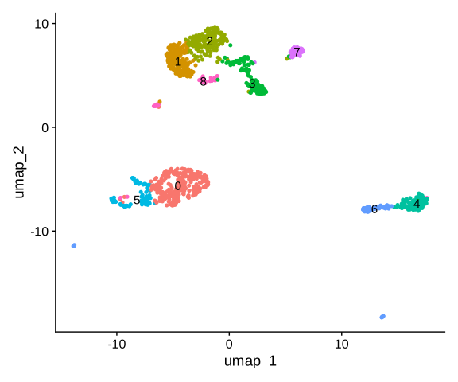
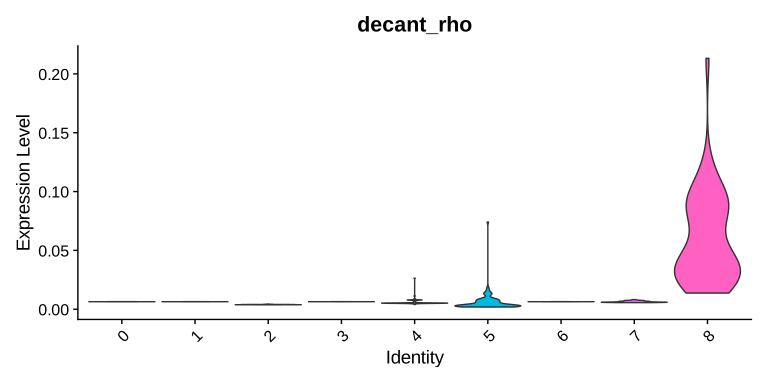
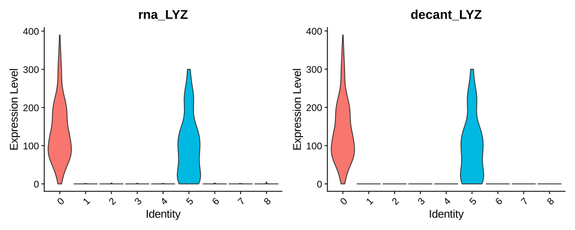

Removing ambient RNA from a Seurat object with Decant
================
Compiled: November 25, 2026

- [Overview](#overview)
- [Load data](#load-data)
- [Standard Seurat processing](#standard-seurat-processing)
- [Run Decant](#run-decant)
- [Effect of the correction](#effect-of-the-correction)
- [Downstream analysis](#downstream-analysis)
- [Notes and limitations](#notes-and-limitations)
- [Session information](#session-information)

This vignette demonstrates how to remove ambient RNA from a Seurat
object with Decant. If you use Decant, please cite:

> *Decant: benchmark-first ambient RNA decontamination for single-cell
> RNA-seq*
>
> Kushal Raj Roy
>
> R package, 2026
>
> GitHub: <https://github.com/kroy3/Decant>
>
> Documentation: <https://decant.readthedocs.io>

# Overview

In droplet-based single-cell RNA-seq, every droplet also captures some
cell-free (“ambient”) RNA released by lysed cells. Each cell’s counts
are a mixture of its own transcripts and this soup, so marker genes of
abundant cell types leak into all the others. Decant measures the soup
from the empty droplets of the raw (unfiltered) matrix, estimates the
contamination fraction of each cell from genes its cluster does not
express, and removes ambient counts from each cell.

Two properties matter for downstream use:

- the corrected counts never exceed the raw counts and are never
  negative: correction only removes counts, it cannot create expression;
- counts too high to be ambient (for example in doublets or rare high
  expressers) are kept rather than removed.

Decant needs the raw droplet matrix (Cell Ranger’s
`raw_feature_bc_matrix`) in addition to the filtered cells.

# Load data

We use the 10x Genomics 1k PBMC dataset (v3 chemistry), which provides
both the filtered and the raw feature-barcode matrices.

``` r
library(Seurat)
library(Decant)
library(ggplot2)
```

``` r
base <- "https://cf.10xgenomics.com/samples/cell-exp/3.0.0/pbmc_1k_v3/pbmc_1k_v3_"
dir <- file.path(tempdir(), "pbmc_1k_v3")
for (which in c("filtered", "raw")) {
    tgz <- file.path(dir, paste0(which, ".tar.gz"))
    dir.create(dir, showWarnings = FALSE)
    if (!file.exists(tgz)) {
        download.file(paste0(base, which, "_feature_bc_matrix.tar.gz"), tgz, mode = "wb")
    }
    untar(tgz, exdir = dir)
}
filtered_dir <- file.path(dir, "filtered_feature_bc_matrix")
raw_dir <- file.path(dir, "raw_feature_bc_matrix")
```

# Standard Seurat processing

Decant uses the object’s cluster identities to estimate contamination,
so we first cluster the cells as usual.

``` r
pbmc <- CreateSeuratObject(Read10X(filtered_dir), min.cells = 3, min.features = 200)
pbmc <- subset(pbmc, subset = nFeature_RNA < 5000)
pbmc <- NormalizeData(pbmc)
pbmc <- FindVariableFeatures(pbmc)
pbmc <- ScaleData(pbmc)
pbmc <- RunPCA(pbmc, verbose = FALSE)
pbmc <- FindNeighbors(pbmc, dims = 1:15)
pbmc <- FindClusters(pbmc, resolution = 0.5)
```

    ## Modularity Optimizer version 1.3.0 by Ludo Waltman and Nees Jan van Eck
    ## 
    ## Number of nodes: 1173
    ## Number of edges: 37289
    ## 
    ## Running Louvain algorithm...
    ## Maximum modularity in 10 random starts: 0.8876
    ## Number of communities: 9
    ## Elapsed time: 0 seconds

``` r
pbmc <- RunUMAP(pbmc, dims = 1:15)
```

``` r
DimPlot(pbmc, label = TRUE) + NoLegend()
```

<!-- -->

# Run Decant

`RunDecant()` reads the raw matrix, takes the droplets with 1 to 100
UMIs as the soup, estimates each cell’s contamination fraction and
writes the corrected counts to a new assay, `Decant`.

``` r
pbmc <- RunDecant(pbmc, raw = raw_dir)
pbmc
```

    ## An object of class Seurat 
    ## 30492 features across 1173 samples within 2 assays 
    ## Active assay: RNA (15246 features, 2000 variable features)
    ##  3 layers present: counts, data, scale.data
    ##  1 other assay present: Decant
    ##  2 dimensional reductions calculated: pca, umap

Each cell’s estimated contamination fraction is stored in `decant_rho`:

``` r
summary(pbmc$decant_rho)
```

    ##     Min.  1st Qu.   Median     Mean  3rd Qu.     Max. 
    ## 0.001861 0.005209 0.006389 0.008079 0.006402 0.213209

``` r
VlnPlot(pbmc, features = "decant_rho", pt.size = 0) + NoLegend()
```

<!-- -->

This is a clean sample: the median cell has well under 1% ambient RNA.

Per-cluster diagnostics are stored in the object’s `Misc` slot. A
cluster flagged `low_power` has too few genes that it clearly does not
express (and that are abundant enough in the soup) to estimate its own
contamination; it borrows the evidence-weighted value of the clusters
that do. With low contamination and closely related immune cell types,
as here, most clusters borrow.

``` r
diag <- Misc(pbmc, "decant")$rho_diagnostics
diag[, c("cluster", "n_cells", "rho", "n_absent_genes", "low_power", "borrowed")]
```

    ##   cluster n_cells         rho n_absent_genes low_power borrowed
    ## 1       0     289 0.006398251              7      TRUE     TRUE
    ## 2       1     182 0.006398251              3      TRUE     TRUE
    ## 3       2     181 0.003939966              5     FALSE    FALSE
    ## 4       3     130 0.006398251              3      TRUE     TRUE
    ## 5       4     125 0.006398251              3      TRUE     TRUE
    ## 6       5      92 0.006398251              2      TRUE     TRUE
    ## 7       6      72 0.006398251              3      TRUE     TRUE
    ## 8       7      55 0.006398251              4     FALSE    FALSE
    ## 9       8      47 0.064703558             27     FALSE    FALSE

# Effect of the correction

The monocyte marker *LYZ* is one of the most abundant genes in the soup.
Its mean count per cell, by cluster, before and after correction: the
small ambient counts in the other clusters are removed, while the
monocyte clusters keep nearly all of theirs.

``` r
lyz <- data.frame(cluster = Idents(pbmc), raw = FetchData(pbmc, vars = "rna_LYZ", layer = "counts")[,
    1], decant = FetchData(pbmc, vars = "decant_LYZ", layer = "counts")[, 1])
aggregate(cbind(raw, decant) ~ cluster, data = lyz, FUN = mean)
```

    ##   cluster         raw       decant
    ## 1       0 136.9826990 136.67072322
    ## 2       1   0.0989011   0.00000000
    ## 3       2   0.1767956   0.02806527
    ## 4       3   0.1307692   0.00000000
    ## 5       4   0.1040000   0.00000000
    ## 6       5 100.2826087  99.81953820
    ## 7       6   0.2083333   0.00000000
    ## 8       7   0.1090909   0.00000000
    ## 9       8   0.3404255   0.00000000

``` r
VlnPlot(pbmc, features = c("rna_LYZ", "decant_LYZ"), layer = "counts", pt.size = 0, ncol = 2)
```

<!-- -->

Correction only removes counts:

``` r
raw_counts <- LayerData(pbmc, assay = "RNA", layer = "counts")
dec_counts <- LayerData(pbmc, assay = "Decant", layer = "counts")
c(min = min(dec_counts), above_raw = sum(dec_counts > raw_counts), share_removed = 1 - sum(dec_counts)/sum(raw_counts))
```

    ##           min     above_raw share_removed 
    ##   0.000000000   0.000000000   0.006410766

# Downstream analysis

The `Decant` assay holds counts; normalize it before use, and use it as
the default assay for marker detection or differential expression.

``` r
pbmc <- NormalizeData(pbmc, assay = "Decant")
DefaultAssay(pbmc) <- "Decant"
markers <- FindMarkers(pbmc, ident.1 = levels(Idents(pbmc))[1], max.cells.per.ident = 200)
head(markers)
```

    ##                p_val avg_log2FC pct.1 pct.2    p_val_adj
    ## S100A8  1.232601e-70   6.357067 0.993 0.089 1.879224e-66
    ## S100A9  5.985638e-69   5.586000 0.990 0.129 9.125703e-65
    ## VCAN    4.585508e-68   5.279421 0.990 0.081 6.991065e-64
    ## MNDA    1.954220e-67   4.527323 0.983 0.110 2.979404e-63
    ## S100A12 4.734851e-67   6.454857 0.969 0.057 7.218754e-63
    ## FCN1    3.115795e-64   3.979669 0.993 0.096 4.750340e-60

# Notes and limitations

- Decant’s contamination estimate relies on genes that a cluster does
  not express. In a sample of a single cell type, or when the soup
  closely resembles every cluster, contamination cannot be estimated
  from the counts; Decant warns, and a value from an independent source
  can be supplied with `RunDecant(pbmc, raw = raw_dir, rho = ...)`.
- Benchmarks against SoupX, DecontX and CellBender, including the cases
  where Decant removes less ambient RNA than DecontX, are documented at
  <https://github.com/kroy3/Decant/blob/main/validation/BENCHMARK.md>.
- For several samples, pass a named list of raw matrices and the
  meta.data column naming each cell’s sample:
  `RunDecant(obj, raw = list(s1 = dir1, s2 = dir2), sample_col = "sample")`.

# Session information

``` r
sessionInfo()
```

    ## R version 4.3.3 (2024-02-29)
    ## Platform: x86_64-pc-linux-gnu (64-bit)
    ## Running under: Ubuntu 24.04.5 LTS
    ## 
    ## Matrix products: default
    ## BLAS:   /usr/lib/x86_64-linux-gnu/blas/libblas.so.3.12.0 
    ## LAPACK: /usr/lib/x86_64-linux-gnu/lapack/liblapack.so.3.12.0
    ## 
    ## locale:
    ## [1] C
    ## 
    ## time zone: Etc/UTC
    ## tzcode source: system (glibc)
    ## 
    ## attached base packages:
    ## [1] stats     graphics  grDevices utils     datasets  methods   base     
    ## 
    ## other attached packages:
    ## [1] ggplot2_3.4.4      Decant_0.4.0       Seurat_6.0.0       SeuratObject_5.4.0
    ## [5] sp_2.1-2          
    ## 
    ## loaded via a namespace (and not attached):
    ##  [1] tidyselect_1.2.0    vipor_0.4.7         farver_2.1.1       
    ##  [4] dplyr_1.1.4         R.utils_2.12.3      fastmap_1.1.1      
    ##  [7] RANN_2.6.1          digest_0.6.34       dotCall64_1.1-1    
    ## [10] lifecycle_1.0.4     cluster_2.1.6       statmod_1.5.0      
    ## [13] magrittr_2.0.3      compiler_4.3.3      rlang_1.1.3        
    ## [16] tools_4.3.3         igraph_1.6.0        utf8_1.2.4         
    ## [19] yaml_2.3.8          data.table_1.14.10  knitr_1.45         
    ## [22] labeling_0.4.3      plyr_1.8.9          RColorBrewer_1.1-3 
    ## [25] KernSmooth_2.23-22  Rtsne_0.17          withr_2.5.0        
    ## [28] R.oo_1.26.0         grid_4.3.3          fansi_1.0.5        
    ## [31] RcppHNSW_0.7.0      fastDummies_1.7.6   colorspace_2.1-0   
    ## [34] future_1.33.1       progressr_0.14.0    globals_0.16.2     
    ## [37] scales_1.3.0        MASS_7.3-60.0.1     ggridges_0.5.6     
    ## [40] cli_3.6.2           rmarkdown_2.25      generics_0.1.3     
    ## [43] ica_1.0-3           future.apply_1.11.1 RSpectra_0.16-1    
    ## [46] sctransform_0.4.3   httr_1.4.7          reshape2_1.4.4     
    ## [49] ggbeeswarm_0.7.2    pbapply_1.7-2       stringr_1.5.1      
    ## [52] parallel_4.3.3      ggrastr_1.0.2       formatR_1.14       
    ## [55] matrixStats_1.2.0   vctrs_0.6.5         Matrix_1.6-5       
    ## [58] jsonlite_1.8.8      patchwork_1.2.0     ggrepel_0.9.5      
    ## [61] beeswarm_0.4.0      irlba_2.4.1         scattermore_1.2    
    ## [64] listenv_0.9.1       limma_3.58.1        pls_2.9-0          
    ## [67] glue_1.7.0          parallelly_1.37.1   spam_2.10-0        
    ## [70] codetools_0.2-19    cowplot_1.1.3       uwot_0.2.5         
    ## [73] RcppAnnoy_0.0.23    stringi_1.8.3       gtable_0.3.4       
    ## [76] munsell_0.5.0       tibble_3.2.1        pillar_1.9.0       
    ## [79] htmltools_0.5.7     R6_2.5.1            evaluate_0.23      
    ## [82] lattice_0.22-5      highr_0.10          png_0.1-8          
    ## [85] R.methodsS3_1.8.2   Rcpp_1.0.12         gridExtra_2.3      
    ## [88] xfun_0.41           pkgconfig_2.0.3
